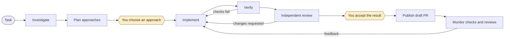
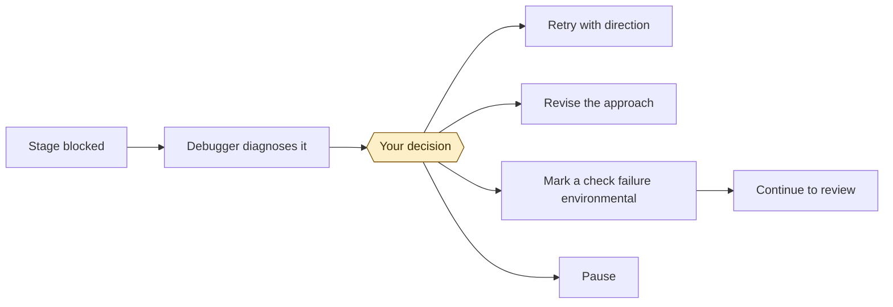
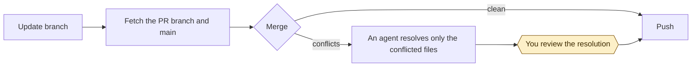
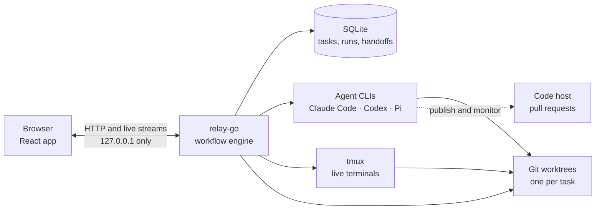

# Relay

**A local workbench for running coding agents through a real engineering workflow, with you
holding the decisions that matter.**

Relay takes a task (an issue, a bug, a feature idea) and moves it through investigation,
planning, implementation, verification and independent review using the agent CLIs you already
have: Claude Code, Codex and Pi. Every stage works in the task's own Git worktree and hands the
next stage a structured report. You approve the approach before any code is written, and you
accept the result before anything is published.

It runs entirely on your machine, binds to `127.0.0.1`, and uses each agent's existing login. No
accounts, no hosted service, no API keys of its own.

- [The workflow](#the-workflow)
- [Features](#features)
- [Getting started](#getting-started)
- [Architecture](#architecture)
- [Trust model](#trust-model)
- [Development](#development)

## The workflow



The hexagons are yours; everything else is an agent. A failed check or a review finding sends
the work back to implementation, up to a repair limit you set. Nothing reaches a pull request
without passing verification and review and getting your acceptance.

Pick a workflow when you create a task:

| Workflow               | What it does                                                                               |
| ---------------------- | ------------------------------------------------------------------------------------------ |
| **Bug fix**            | Reproduces the behaviour, repairs it, and adds a focused regression check                  |
| **Small change**       | A focused change with a concise proposal                                                   |
| **Investigate only**   | Gathers evidence and stops with findings; no implementation                                |
| **Cross-repo feature** | One plan covering contracts and dependencies across repositories, each in its own worktree |

Each stage can go to a different agent (say, Codex to implement and Claude to review), with the
model and effort set per task.

### When a stage gets stuck



A blocked stage never guesses. It stops, explains what went wrong with evidence and options,
and waits. If a check failed because of your environment rather than the change (a local service
that isn't running, a test that fails on main too), you can say so, with a reason that's kept on
record, and send the work on to independent review.

## Features

**See everything.** A board and list of tasks by stage; a task deck to watch several side by
side; and for each task its live activity, logs, structured handoffs, diff, and an execution
graph of every run with its duration.

**Stay in control.** Approve approaches, comment inline on the diff, request changes, and accept
results. Auto mode can be granted per task when you want it to carry on without you.

**Work in the worktree yourself.** Watch an agent's terminal live, or open your own agent or shell
in a task's worktree, briefed on the task, in tmux in the browser. Relay holds that task's stages
while you work and keeps everything else running. Full manual takeover is there too.

**Pull requests.** Publish a draft PR, monitor checks and reviews, let agents address feedback,
and bring a branch up to date with its mainline:



A clean merge is pushed in seconds, with the pull request's CI as the check. Pushes never force.

**Ask Relay.** Read-only chats about your tasks and their worktrees. Anything it suggests changing
comes back as a proposal for you to approve.

**Keep work safe.** Checkpoints you can restore into a fresh worktree, continuations from earlier
decisions, disk use per task, guarded cleanup of finished worktrees, and export and import of
Relay's state.

## Getting started

### Requirements

- macOS or Linux, with Git
- Go 1.22+, a C compiler, `pkg-config` and SQLite development headers
- Node.js 24+ and pnpm, to build the frontend
- At least one agent CLI, already logged in: [Claude Code](https://claude.com/claude-code),
  Codex or Pi
- tmux, optional, for live terminals

### Build and run

```sh
pnpm install --frozen-lockfile
pnpm run build   # the web app, then .relay/bin/relay-go
pnpm start       # .relay/bin/relay-go --data-dir .relay/state --web-dir web/dist --port 4310
```

Then open <http://127.0.0.1:4310>, add a repository, and create a task.

- The state directory must be new or empty the first time. After that it belongs to this
  instance, and a second Relay can't open it.
- Relay hands its own environment to every agent and terminal it starts, so launch it from the
  shell you normally work in. Agents then see the same tools and logins you do.
- Stop it with Ctrl+C. Running agents are stopped, and interrupted work waits for you to resume
  it; nothing is rerun blindly.
- Local profiles, helper scripts and state go in `.relay/`, which Git ignores.

### Staying up to date

When Relay runs from a clone of this repository (`pnpm run build`, then `pnpm start`), it keeps
itself current. Every 30 minutes it fetches `main`, and when a newer commit there has passed CI
it waits until no agent, chat or terminal is working, fast-forwards, rebuilds and restarts into
the new build. It leaves the checkout alone if you have local changes, local commits or another
branch checked out, and it rolls back if the update doesn't build. Turn it off, or check now,
under **Settings → Updates**. Reading CI results for a private repository uses your `gh` login or
`GITHUB_TOKEN`.

## Architecture



| Directory | What's in it                                                                   |
| --------- | ------------------------------------------------------------------------------ |
| `go/`     | The service: workflow engine, agent harnesses, worktrees, storage and HTTP API |
| `web/`    | The React and TypeScript frontend, served from `web/dist`                      |

The Go service has no third-party Go dependencies. Each task gets its own branch and worktree,
and only one writer at a time holds a shared repository, so two agents never edit the same
checkout. More on storage, export and import is in [go/README.md](go/README.md).

## Trust model

Relay is built for one developer on their own machine. Agents run as your OS user with your
filesystem and network access. **Relay is not a sandbox.**

What it does enforce:

- **Isolation.** Every task works in its own worktree, with one writer per repository.
- **Gates.** Implementation needs your approved approach; publication needs your acceptance.
- **Evidence.** Verification has to run real checks, and a failed or missing check blocks progress.
- **Integrity.** Workspace fingerprints catch any change made after verification or review.
- **Untrusted input.** Ticket and issue text is context for agents, never instructions or commands.
- **Publishing.** Agents never merge. Only the publication step pushes, and Relay itself pushes
  only when you update a branch, never with force.

Review the diff before you accept it.

## Development

```sh
pnpm test              # Go and web unit tests
pnpm run check         # gofmt, go vet, the TypeScript check and Prettier
pnpm run test:browser  # end-to-end, workspace and UI audit suites in a real browser
```

The browser suites use throwaway state and repositories. Install Playwright's Chromium, or set
`RELAY_CHROME` to a Chrome or Chromium executable. Contribution rules are in
[AGENTS.md](AGENTS.md).

## License

[MIT](LICENSE)
